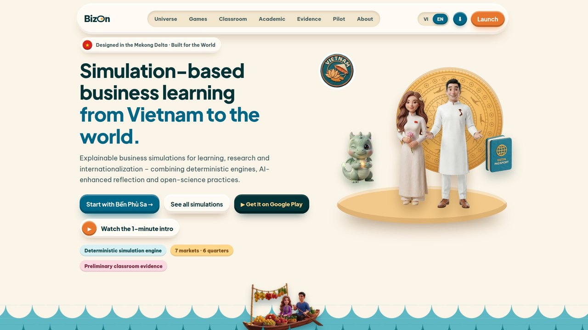
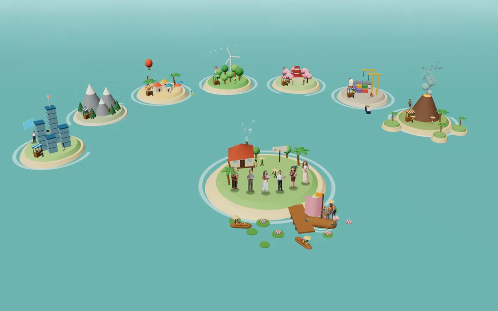
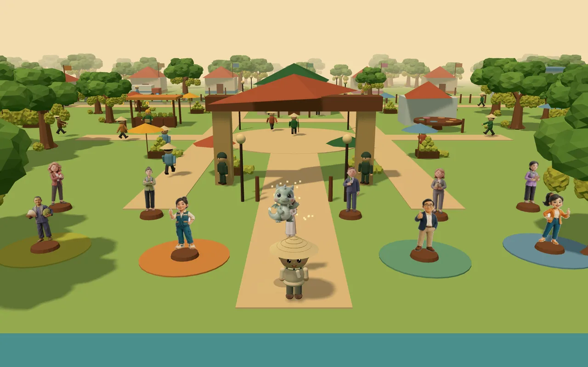

<div align="center">

<a href="https://bizonland.com/"></a>

# BizOn

**Simulation-based business learning, from Vietnam to the world.**<br>
*Học kinh doanh qua mô phỏng – từ Đồng bằng sông Cửu Long ra thế giới.*

Explainable, clay-styled 3D business simulations for learning, research and internationalization.<br>
They pair deterministic engines with AI-enhanced reflection and open-science practice.

[](https://bizonland.com/)
[](https://play.google.com/store/apps/details?id=io.github.thuyhuongctu.bizon)
[](https://doi.org/10.5281/zenodo.21592241)


</div>

---

## 🎬 BizOn in one minute

<div align="center">

<a href="https://bizonland.com/assets/video/bizon-intro-1min-en-v2.mp4">
  
</a>

**[▶ Watch the 1-minute intro](https://bizonland.com/assets/video/bizon-intro-1min-en-v2.mp4)** · 63 s · English narration · music: *And The World Say Hello! (Original)*<br>
<sub>An animated walkthrough of bizonland.com: roles, the three game levels, support tools, trailers, evidence and the theory-to-decision flow. You can also <a href="assets/video/bizon-intro-1min-en-v2.mp4">download the MP4</a>.</sub>

</div>

---

## 🎮 Three game levels

Start at Level 1. Each level builds on the one before, and every game has a 3D version and a 2D version.

<table>
<tr>
<td width="50%" valign="top">
<a href="https://bizonland.com/ben-phu-sa-3d.html"></a>

**Level 1 · Venture start-up — Bến Phù Sa**<br>
A riverside street-vendor start-up on a Mekong floating market. Each week you pick a Method, Product and Location, and learn when to test cheaply and when to scale.<br>
<sub>5 weeks · solo or team play</sub><br>
[Play in 3D](https://bizonland.com/ben-phu-sa-3d.html) · [3D team play](https://bizonland.com/ben-phu-sa-v8.html) · [2D](https://bizonland.com/ben-phu-sa.html) · [Trailer](https://bizonland.com/assets/video/ben-phu-sa-trailer-v2-720p.mp4)
</td>
<td width="50%" valign="top">
<a href="https://bizonland.com/BizOn%20Game%203D.html"></a>

**Level 2 · Running a business — Bật Nghiệp**<br>
Build and run a company through multi-round strategic decisions in a Vietnamese market. You face three rival CEOs, and the AI advisor Lumina guides you.<br>
<sub>6 decision rounds · market arena</sub><br>
[Play in 3D](https://bizonland.com/BizOn%20Game%203D.html) · [2D](https://bizonland.com/game.html) · [Trailer](https://bizonland.com/assets/video/bizon-trailer-v3-720p.mp4)
</td>
</tr>
<tr>
<td width="50%" valign="top">
<a href="https://bizonland.com/Ho%20Chieu%20Thuong%20Hieu%203D.html"></a>

**Level 3 · Internationalisation — Brand Passport**<br>
Take a Vietnamese brand across borders through market intelligence, entry strategy, adaptation and resilience.<br>
<sub>6 quarters · 7 markets</sub><br>
[Play in 3D](https://bizonland.com/Ho%20Chieu%20Thuong%20Hieu%203D.html) · [2D](https://bizonland.com/brand-passport.html) · [Lite 3D](https://bizonland.com/Ho%20Chieu%20Mini%203D.html) · [Lite 2D](https://bizonland.com/Ho%20Chieu%20Mini.dc.html) · [Trailer](https://bizonland.com/assets/video/bp-trailer-v2-720p.mp4)
</td>
<td width="50%" valign="top">
<a href="https://bizonland.com/lab/ho-chieu-sau-rieng-3d.html"></a>

**Level 3 · Internationalisation — Durian Passport**<br>
Take Vietnamese durian to the world over 6 seasons on a walkable 3D map. Topics include planting-area codes, the China phytosanitary protocol, official versus border trade, and frozen and premium markets.<br>
<sub>6 seasons · teams of 5 roles vs AI rivals</sub><br>
[Play in 3D](https://bizonland.com/lab/ho-chieu-sau-rieng-3d.html) · [2D](https://bizonland.com/lab/ho-chieu-sau-rieng.html) · [Classroom playbook](https://bizonland.com/lop-hoc.html) · [Trailer](https://bizonland.com/assets/video/srp-trailer-720p.mp4)
</td>
</tr>
</table>

## 🧰 Support tools

Use these alongside the games to practise one model or skill at a time.

| Tool | What it does |
|---|---|
| 🌏 **[IE Lab](https://bizonland.com/global.html)** · strategy model | Experiment with internationalization assumptions and see how strategic variables change the outcomes. |
| 🧪 **Practicum labs**, one session each | **[CMR Lab](https://bizonland.com/lab/cmr-lab.html)**: contribution margin ratio, seen through four lenses.<br>**[CVP Lab](https://bizonland.com/lab/cvp-studio.html)**: cost–volume–profit, break-even and margin of safety.<br>**[Gravity Lab](https://thuyhuongctu.github.io/Gravity-Lab/)**: the gravity model of trade and FDI into Viet Nam (OLS and PPML in the browser). [Trailer](https://bizonland.com/assets/video/gravity-lab-trailer-720p.mp4)<br>**[FDI Lab](https://bizonland.com/lab/nha-may-fdi.html)**: an FDI factory run over 8 quarters (local content, rules of origin, transshipment). |
| 🕹️ **[Arcade](https://bizonland.com/games.html)** · skill drills | Short, focused simulations, each practising one business skill or decision pattern. |
| 🎵 **[Soundtrack](https://bizonland.com/am-nhac.html)** | The original music library. You can play whole albums, set a sleep timer and download tracks. |

## 👥 Start from your role

| You are… | Go to |
|---|---|
| **Student** | Play a short round, make decisions and get feedback from Lumina. Start with [Bến Phù Sa →](https://bizonland.com/ben-phu-sa-3d.html) |
| **Instructor** | Run a class, follow decision traces and grade with rubrics: [Instructor corner](https://bizonland.com/giang-vien.html) · [Class dashboard](https://bizonland.com/Trang%20Giang%20Vien.dc.html) · [Instructor page](https://bizonland.com/truong-giang-vien.html) · [Classroom playbook](https://bizonland.com/lop-hoc.html) |
| **Researcher** | Review the models, assumptions, equations and published limitations: [Academic framework](https://bizonland.com/truong-hoc-thuat.html) |
| **Institution · partner · funder** | See the pilot results and how to deploy BizOn at your institution: [Evidence](https://bizonland.com/bang-chung.html) · [Solutions](https://bizonland.com/giai-phap.html) |

Everything starts at **[Universe BizOn](https://bizonland.com/universe.html)**, a one-page map of the ecosystem.

## 🔬 Evidence before marketing

- **Explainable engine:** core scoring is deterministic, so every result can be inspected, discussed and reproduced. No language model runs in the scored loop.
- **Observable decisions:** strategic choices leave traces that support debriefing, rubrics, reflection and classroom analysis.
- **Learning evidence:** the game mechanics are linked to learning outcomes, pre/post measures and documented limitations. A preliminary classroom pilot ran with 40 learners.
- **AI interprets; it does not score:** Lumina asks reflective questions, but the engine and the rubric decide the results.

The engine layer is small and covered by tests. It includes a shared decision-log schema with a consent gate that is off by default ([`js/decision-log.js`](js/decision-log.js)) and frozen co-cohort snapshots for reproducible grading ([`js/aibis/round-swap.js`](js/aibis/round-swap.js)). It also has deterministic strategy prototypes with a diversity health metric ([`js/aibis/anchor-profiles.js`](js/aibis/anchor-profiles.js)). These contracts are guarded by Node tests in `test/` that run in CI. The legal and ethics questions around learner data are documented for counsel and the ethics board, not answered in code. See [`docs/learning/CONSENT-FRAMEWORK-DRAFT-V1.md`](docs/learning/CONSENT-FRAMEWORK-DRAFT-V1.md).

## 🚀 Run locally

BizOn is a static site, so there is nothing to install or build.

```bash
git clone https://github.com/thuyhuongctu/BizOn.git
cd BizOn
python3 -m http.server 8000   # open http://localhost:8000
```

| Channel | How it ships |
|---|---|
| **Web** | [`deploy-pages.yml`](.github/workflows/deploy-pages.yml) deploys to GitHub Pages ([bizonland.com](https://bizonland.com/)) on every push to `main`. |
| **PWA** | Open the site on a phone and tap *Add to Home Screen*. It runs full-screen and works offline through the service worker ([`sw.js`](sw.js)). |
| **Android** | [Google Play](https://play.google.com/store/apps/details?id=io.github.thuyhuongctu.bizon): a Trusted Web Activity that opens this web app, so it always runs the latest version. |

Game progress is saved in each device's `localStorage`. Every page supports light and dark mode and a Vietnamese/English interface.

<details>
<summary><b>🧱 Source layout</b></summary>

```
index.html                 # Homepage (clay design system); mirrored by academia3d-v2.html
universe.html              # Ecosystem map – the landing page for the whole project
ben-phu-sa*.html           # Level 1 · Bến Phù Sa (3D solo, 3D team play, 2D)
BizOn Game 3D.html, game.html                    # Level 2 · Bật Nghiệp (3D, 2D)
Ho Chieu Thuong Hieu 3D.html, brand-passport.html # Level 3 · Brand Passport
lab/                       # Durian Passport + practicum labs (CMR, CVP, FDI)
global.html, games.html    # IE Lab · Arcade
am-nhac.html               # Soundtrack (js/am-nhac-clay.js + js/music-data.js)
css/bizon-clay.css         # Clay design system (tokens, nav, cards)
js/                        # Engines, game UI, i18n, shared clay nav
sw.js                      # Service worker – app shell, offline play, update channel
assets/                    # Characters, covers, audio, video, self-hosted fonts
BizOn Intro.dc.html, bizon-intro.jsx  # Source of the 1-minute intro animation (docs/intro/)
android/                   # TWA config for the Google Play release
docs/                      # Instructor guides, academic docs, store assets
test/                      # Node contract tests run in CI
```

</details>

## 📚 Cite BizOn

If you use BizOn in teaching or research, please cite:

> Do, T. H., & Phan, A. T. (2026). *BizOn Bật Nghiệp: A 3D claymorphism business-simulation game for entrepreneurship education* (Version v.1.3) [Computer software]. Zenodo. https://doi.org/10.5281/zenodo.23325489

- The machine-readable citation is in [`CITATION.cff`](CITATION.cff); GitHub shows a **Cite this repository** button for it.
- Zenodo version DOI for v1.3: [10.5281/zenodo.23325489](https://doi.org/10.5281/zenodo.23325489).
- Concept DOI covering all versions: [10.5281/zenodo.21592241](https://doi.org/10.5281/zenodo.21592241). Each GitHub release is archived with its own DOI.

## ⚖️ Copyright & intellectual property

**Proprietary software:** see [`LICENSE`](LICENSE). The authors **Do Thuy Huong & Phan Anh Tu** own:
- the source code and the simulation-engine algorithms;
- the character designs (**Lumina**, **Tú Phan**, the Demo Team);
- the original music library;
- the **BizOn** name and identity.

✅ **Free tiers (limited scope):**
- The **BizOn Arcade** and the **Level-1 game** are free to use at the official URL, with no time limit.
- Any institution may use the **two pillars**, *Bật Nghiệp* and *Hộ chiếu Thương hiệu*, free for **one trial semester**.
- **Can Tho University** uses the two pillars under a written licence granted by the authors; the licence names the authors as owners and does not transfer any right.

❌ **Outside those tiers, a written license is required** for:
- continued use of the two pillars at other institutions;
- the **Instructor Studio**;
- copying or re-deploying the source;
- extracting the characters or the music;
- any use that charges a fee.

To request a license, write to bricoleur@bizonland.com.

The authors' private document repository holds the registration dossiers (copyright and trademark) and the commercialization strategy.

**Fonts and libraries:** the fonts are self-hosted `.woff2` files in `assets/fonts/` (Be Vietnam Pro, Plus Jakarta Sans, Manrope, IBM Plex Mono, DM Serif Display, Nunito and Baloo 2), all under the **SIL Open Font License 1.1**. The vendored libraries (three.js, GSAP, D3, React, PeerJS, auto-animate, a purged Tailwind CSS build) keep their own licences. The main pages load no font or script from a third-party CDN at runtime; the few internal pages that still do are listed, with every other third-party component, in [`THIRD-PARTY-NOTICES.md`](THIRD-PARTY-NOTICES.md).

## 🧑‍🔬 Authors

| | |
|---|---|
| **Do Thuy Huong** | Founder & Project Lead · PhD candidate in Business Administration, Can Tho University. Research in internationalization strategy, firm performance, meta-analysis, quantitative methods and AI-assisted management research. |
| **Assoc. Prof. Dr. Phan Anh Tu** | Co-founder & Chief Academic Advisor. Responsible for academic direction, model review and classroom implementation design. |

<div align="center">

**Vision:** a Mekong Delta where young people do not have to leave home to build a livelihood. They start enterprises on their own soil and bring Vietnamese products to the world.

[bizonland.com](https://bizonland.com/) · bricoleur@bizonland.com · Can Tho University, Vietnam

<sub>© 2026 Do Thuy Huong & Phan Anh Tu · BizOn Bật Nghiệp · All rights reserved.</sub>

</div>
